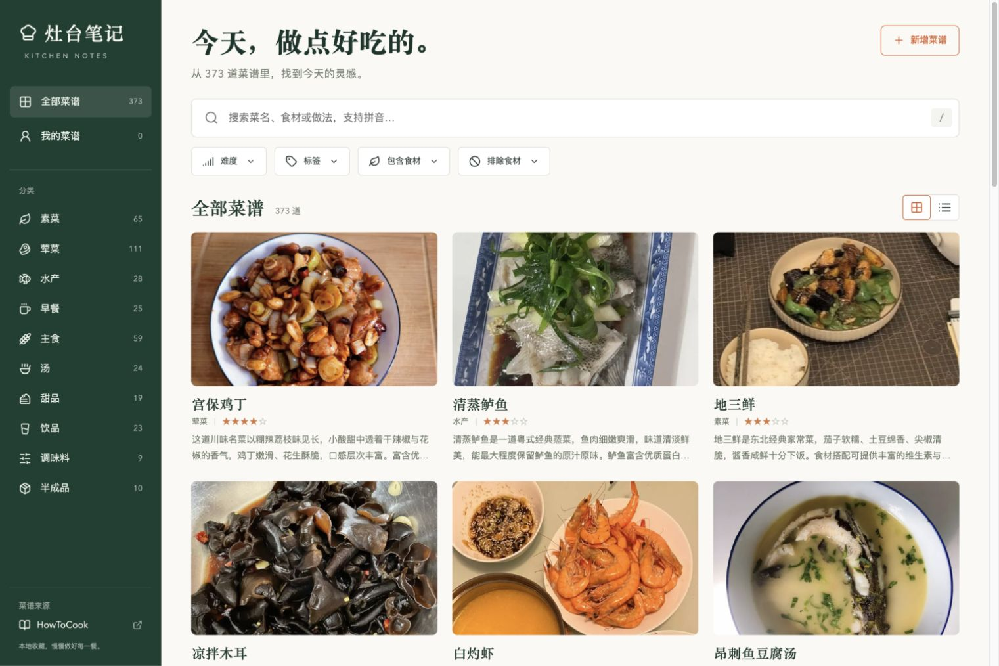

# 灶台笔记 · 本地菜谱站

React + TypeScript + Vite 菜谱库，支持本地文件模式和 Cloudflare Workers 云端模式。网页可全文搜索、按拼音检索、组合筛选，并提供分步烹饪、备料勾选和厨房计时。云端模式增加在线菜谱管理、邮箱密码登录、游客点菜与投稿、管理员审核、R2 照片、账号收藏和 Resend 邮件通知。

云端部署沿用现有 `personmenu` Worker 的静态资源服务和同站点 API，无需租用常驻服务器。**配置获取入口、每个变量的填写位置、SQL 执行顺序、首次导入、管理员授权和生产发布步骤见 [DEPLOYMENT.md](DEPLOYMENT.md)。** 云端数据以 Supabase 为准；未配置云端服务时，以下本地文件工作流仍可使用。

[MIT License](LICENSE) · [贡献指南](CONTRIBUTING.md) · [问题反馈](https://github.com/LJLisgood/PersonMenu/issues)



## 开始使用

需要 Node.js 22.12+（推荐 Node 22 LTS）与 npm。

```bash
git clone https://github.com/LJLisgood/PersonMenu.git
cd PersonMenu
npm ci
npm run dev
```

打开终端打印的本地地址。`npm run dev` 会先生成菜谱数据，保存 `content/` 中的文件后自动重建并刷新。遇到元数据或图片错误，页面和终端会提示具体文件；修正后再次保存即可。

```bash
npm test                  # 生成本地内容并运行回归测试
npm run content:validate  # 检查数据，不转换图片
npm run build             # 内容处理、TypeScript 检查与生产构建
npm run preview           # 查看 dist/ 中的生产构建
```

普通构建完全读取已有本地内容，不下载上游；首次安装依赖需要网络。静态网站需要 HTTP 服务，不能通过直接双击 index.html 使用。

## 快速添加菜谱

在项目根目录运行：

```bash
npm run recipe:new -- --name "妈妈的红烧肉" --category "家常菜"
```

生成 `content/personal/妈妈的红烧肉/妈妈的红烧肉.md` 和 `images/` 目录。个人菜名重复时命令拒绝覆盖。与上游同名的个人版本可以共存。

1. 编辑 Markdown 的食材、用量、步骤和备注。
2. 将照片放进同目录的 `images/`；取消 `cover: ./images/cover.jpg` 前的注释。
3. 根据实际情况填写 `difficulty`（1–5）、`totalMinutes`、`servings` 或 `tags`，也可以全部留空。
4. 本地预览确认后提交文件，需要更新公开网站时，再运行 GitHub Pages 发布工作流。

```bash
git add content/personal
git commit -m "添加一道新菜谱"
git push
```

`id` 必须保留并且全库唯一；修改菜名或移动文件时不要改变它。封面用相对路径，本地资源不能指向内容目录外。用量公式作为文字保留，不会自动换算。

网页的“新增菜谱”提供命令生成器与可下载模板；浏览器不会自动改写项目文件。模板手动创建时需要填写唯一 ID。

## 首页与本机收藏

首页提供真实菜谱封面、快捷分类、按本机日期更新的每日推荐和最近浏览；「帮我选一道」可随机选择真实菜谱。全部菜谱页继续提供完整搜索筛选，也可以从当前筛选结果中抽取。

「我的菜谱」仍是 `content/personal/` 中的个人文件；「我的收藏」是当前浏览器内保存的菜谱 ID。收藏、最近浏览和详情步骤标记不会写入菜谱文件，也不跨设备同步。浏览器存储不可用时，页面显示提示并暂用内存保存。最近浏览最多保留 40 条，首页显示最近 6 条。

无 Hash 的首次入口和 `#/home` 打开首页；原 `#/` 仍打开全部菜谱。收藏与历史入口分别为 `#/favorites`、`#/recent`。完整实现说明和待执行验收见 [UI 改版交接](UI-REDESIGN.md)。仓库现有界面截图为改版前版本。

## 检索与烹饪

- 菜名、食材、标签、全部正文可中文全文检索；菜名和食材还支持全拼与首字母，例如 `xihongshichaojidan` / `xhscjd`。
- 分类、来源、难度、标签、食材包含和排除条件取交集。多个食材用中英文逗号或顿号分隔。包含要求全部命中，排除命中任一个即隐藏。
- 食材筛选使用原料文字，未实现同义词推断，不作为过敏判断。缺少难度的菜谱在“全部难度”中显示。
- 搜索和筛选保存在 Hash URL 中；刷新、分享和返回菜谱库会恢复条件。桌面 `/` 键聚焦搜索。
- 烹饪模式保留步骤中的嵌套说明、图片与文字；无法可靠拆分的菜谱显示完整原文。可以随时切换原文、查看用量与备注。
- 浏览器 localStorage 保存收藏、浏览记录、视图偏好、详情步骤标记，以及做菜进度、备料勾选和计时结束时间。后台恢复、刷新后计时按实际时间校正。浏览器关闭后不保证响铃，也没有跨设备同步。
- 屏幕常亮、全屏和提醒声音取决于浏览器与设备支持，失败不影响阅读。

## HowToCook 菜谱数据

首次固定导入 [Anduin2017/HowToCook](https://github.com/Anduin2017/HowToCook) commit `3dfa950f6daf0a5b311fc46619f1b559bac980c4`，含 373 篇实际菜谱；模板不进入列表。`content/howtocook/dishes/` 只保存正式菜谱及其实际引用的本地资源，`tips/` 只保存菜谱直接或间接引用的厨房知识文件。保留原始路径与内容，不复制上游项目工程、README、示例模板或未引用资源。

保留 [Unlicense](content/howtocook/LICENSE) 和 `content/howtocook/upstream.json`，后者记录版本、内容校验值及更新差异。菜谱详情可打开固定版本来源原文。

显式更新到一个完整 commit SHA：

```bash
npm run upstream:update -- --commit <40位commit>
```

也可从已经下载的对应版本归档导入：

```bash
npm run upstream:update -- --commit <40位commit> --archive /绝对路径/source.tar.gz
```

更新只替换上游目录，保留个人内容；验证失败恢复旧上游。提交变更前检查上游记录中的 `changes`。普通构建不会自动更新上游。更新时归档下载到系统临时目录，只将筛选后的菜谱数据写入项目；下载量仍约百 MB，速度取决于网络。

内容报告位于 `public/data/import-report.json`（构建生成、Git 忽略）。它列出无法分步的菜谱、外部引用和失效的本地引用。该固定版本存在 3 个上游失效内部链接，没有缺失本地图片；网页提示失效引用并保留原文。个人菜谱缺失图片或本地文件会使构建失败。外部图片以说明文字呈现，核心展示不依赖远程图片。

## GitHub Pages 发布

仓库提供 [GitHub Pages 工作流示例](docs/github-pages.yml)。先将它复制到 `.github/workflows/pages.yml` 并提交到仓库，再手动运行以发布 GitHub Pages。通过访问令牌提交工作流文件时，需要相应的工作流写入权限。公开源代码与发布网站是两个独立步骤；默认不会因推送自动部署。

在 GitHub 仓库 Settings → Pages 中把 Source 设为 **GitHub Actions**，再从 Actions 页面手动运行 **Publish recipe library**。如需推送后自动部署，可自行给工作流添加 `push` 触发器。工作流执行内容验证、测试与生产构建，再部署 `dist/`。构建时自动使用 `/<仓库名>/` 基础路径；Hash 路由无需服务器回退规则。

若使用 `<用户名>.github.io` 用户站点仓库或自定义域名，请将工作流中的 `BASE_PATH` 改为 `/`。本地模拟仓库子路径：

```bash
BASE_PATH=/PersonMenu/ npm run build
npm run preview
```

浏览器打开 `/PersonMenu/`。回到本地根路径构建时运行普通 `npm run build`。公开 Pages 站点中的菜谱、照片和原文可被下载；私人菜谱在发布前需自行决定是否公开。

## 项目结构与生成边界

- `content/howtocook/`：固定版本上游原文、配图、来源记录。
- `content/personal/`：你维护的菜谱与图片，唯一内容来源。
- `scripts/`：AST 解析、资源校验、图片优化、索引生成、新建和上游导入。
- `src/`：React 页面、搜索 Worker、Hash 路由与烹饪状态。
- `public/data/`、`public/media/`：可重建的 JSON、MiniSearch 索引、详情图及缩略图；不提交 Git。
- `dist/`：完整静态发布产物；不提交 Git。
- `docs/`：项目界面截图与可选 GitHub Pages 工作流示例。

Markdown 在构建时转成经过 sanitize 的 HTML，原始 HTML 不执行。搜索在 Worker 内运行，详情按菜谱请求，卡片图片懒加载。列表分批渲染，图片使用 WebP 缩略图；原始照片始终保留在内容目录中。

## 参与贡献

欢迎通过 [Issues](https://github.com/LJLisgood/PersonMenu/issues) 报告问题，或提交 Pull Request。提交前请阅读 [贡献指南](CONTRIBUTING.md)，运行 `npm test` 与 `npm run build`。修复上游菜谱原文请优先向 HowToCook 提交；自己的版本放入 `content/personal/`。

## 许可证与致谢

本项目原创应用代码、脚本及文档采用 [MIT License](LICENSE)。

`content/howtocook/` 来自 [Anduin2017/HowToCook](https://github.com/Anduin2017/HowToCook)，保留其 [Unlicense](content/howtocook/LICENSE)、原文及来源记录；该目录不由本项目 MIT 许可证重新授权。感谢原项目及所有菜谱贡献者。第三方依赖遵循各自许可证。

向本仓库贡献内容时，请确保你有权公开所提交的文字和图片，并同意原创贡献按本项目许可证发布。不要提交私人菜谱、无授权照片或敏感信息。

### DeepSeek 菜谱整理（可选）

管理员新增菜谱时可粘贴 OCR 文字或零散做法，点击「AI 整理并填入」。请求期间显示 ThoughtLine 进度与计时；成功后填入可编辑表单，仍需人工核对并保存。缺失信息保持为空，失败不会覆盖原有内容。

在本地 `.dev.vars` 设置 `DEEPSEEK_API_KEY`，线上使用 `npx wrangler secret put DEEPSEEK_API_KEY`。可选服务端变量 `DEEPSEEK_MODEL` 默认 `deepseek-flash`。密钥不得放入 `VITE_*` 或提交到仓库。本地完整功能使用 `npm run build:cloud` 后运行 `npm run dev:cloud`。

原文将发送给 DeepSeek。一次仅整理一道菜，最多 15000 字，每管理员每个 15 分钟窗口最多 10 次；请求超时 60 秒，不自动重试。API 费用及模型可用性以 DeepSeek 账户为准。参考 [DeepSeek JSON Output 文档](https://api-docs.deepseek.com/guides/json_mode)。
